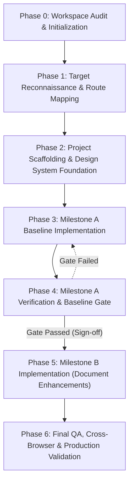

# Octis Website Recreation & Enhancement — Project Plan

## 1. Project Overview & Objectives

This project executes a disciplined, two-milestone engineering workflow to reproduce and subsequently modernize the web presence of Octis ([https://octis.in/](https://octis.in/)), a cloud-based Jewellery Shop Management Software platform tailored for Indian retail jewellers.

### Deliverables & Milestones
- **Milestone A — Baseline Replica**: Reconstruct the publicly accessible Octis website, preserving its actual structure, verified copy, visual design, responsive behavior across mobile/desktop, and relevant interactions.
- **Milestone B — Requested Modifications**: Apply the UI/UX enhancements and content adjustments specified in the developer document (`OCTIS_UIUX_Complete_Audit_and_Fix_Blueprint.docx`), while strictly preserving unaffected content and SEO structure.

> **CRITICAL RULE**: No Milestone B modification work may begin until Milestone A has been fully implemented, reviewed, and passed baseline verification.

---

## 2. Phased Execution Lifecycle

### Phase 0: Workspace Audit and Project Initialization (Current)
- **Objective**: Audit the development environment, verify runtimes, check toolchains and browsers, assess cloning tool feasibility, confirm site accessibility, locate project assets/documents, and establish tracking documentation.
- **Dependencies**: None.
- **Acceptance Criteria**:
  - Environment audit and implementation log established in `docs/`.
  - Node.js, npm, Git, browser paths, and network connectivity to `https://octis.in/` confirmed and recorded.
  - Location and integrity of the developer document verified.
  - Evaluation of candidate cloner template documented with fallback strategy.
  - Zero application code written; no website construction started.

### Phase 1: Target Site Reconnaissance & Route Mapping
- **Objective**: Systematically inspect `https://octis.in/` using browser inspection tools and direct HTTP analysis.
- **Scope**:
  - Discover all routes, anchors, redirects, modals, and dynamic states (e.g., login, request demo form, scheme drawers).
  - Extract typography rules, font families, exact color tokens (HSL/HEX/OKLCH), layout spacing, and breakpoint behavior.
  - Inventory and catalog all assets: logos, SVGs, icons, illustrations, photography, and favicon.
  - Capture desktop (1440px, 1280px) and mobile (375px, 390px) screenshots as baseline references.
- **Dependencies**: Phase 0 sign-off.
- **Acceptance Criteria**:
  - Route inventory document created mapping all live URLs and states.
  - Complete asset catalog populated with downloaded/verified public assets.
  - Style sheet reference guide (colors, typography, grid/spacing) established.

### Phase 2: Project Scaffolding & Design Foundation
- **Objective**: Initialize a clean, robust frontend application skeleton matching the required tech stack.
- **Scope**:
  - Initialize project (Next.js App Router / React with TypeScript strict mode, or Vite+React per architectural decision).
  - Configure styling framework (Tailwind CSS v4 with custom design tokens matching Octis brand styles).
  - Set up component structure (`src/components/`, `src/lib/`, `public/assets/`).
  - Establish SEO metadata baseline (OpenGraph, meta tags, viewport configurations matching live site).
- **Dependencies**: Phase 1 reconnaissance.
- **Acceptance Criteria**:
  - Clean build without errors (`npm run build` passes).
  - Design tokens, global CSS, and typography correctly rendered.

### Phase 3: Milestone A Implementation (Baseline Replica)
- **Objective**: Faithfully build the baseline replica of the live Octis website.
- **Scope**:
  - Construct header, navigation, and mobile hamburger drawer.
  - Construct hero section with live headline copy, metrics counter cards, and CTAs.
  - Construct core feature grid (POS, inventory, metal rate sync, CRM, karigar management, analytics).
  - Construct compliance showcase (BIS hallmarking, HUID, IT Act / KYC, PMLA / FIU reporting).
  - Construct pricing tiers (Starter, Professional, Enterprise) and FAQ accordion.
  - Construct footer with contact details, links, and copyright notice.
  - Implement interactive states (smooth scroll anchors, accordion toggles, mobile menu toggle, modals).
- **Dependencies**: Phase 2 scaffolding.
- **Acceptance Criteria**:
  - All public sections visible on `https://octis.in/` exist in code.
  - Exact copy and branding match the live site.
  - Responsive behavior matches desktop and mobile viewports.

### Phase 4: Milestone A Verification & Baseline Gate
- **Objective**: Conduct rigorous visual and functional QA against the live website before any modifications begin.
- **Scope**:
  - Side-by-side visual comparison at 1440px desktop and 375px mobile viewports.
  - Verify asset fidelity, layout alignment, typography, and contrast.
  - Test responsive breakpoints (desktop, tablet, mobile).
  - Validate interactive states: menu open/close, FAQ accordions, anchor jumps.
  - Production build and lint validation.
- **Dependencies**: Phase 3 implementation.
- **Acceptance Criteria (BASELINE GATE)**:
  - Strict sign-off checklist verified and recorded in `docs/implementation-log.md`.
  - Zero missing sections or unstyled elements.
  - Successful production build.
  - **MANDATORY**: Only upon passing this gate may Phase 5 be authorized.

### Phase 5: Milestone B Implementation (Requested Enhancements)
- **Objective**: Apply the UI/UX and content updates specified in `OCTIS_UIUX_Complete_Audit_and_Fix_Blueprint.docx`.
- **Scope**:
  - Ingest audit recommendations, architectural changes, typography/hierarchy updates, and UI polish.
  - Update sections as instructed by the developer document while preserving untouched copy and SEO tags.
  - Maintain clean, modular component boundaries for modified components.
- **Dependencies**: Phase 4 Baseline Gate sign-off.
- **Acceptance Criteria**:
  - Every explicit enhancement requirement from the developer document implemented.
  - Non-modified areas remain intact and functional.

### Phase 6: Milestone B Verification & Final QA
- **Objective**: Complete end-to-end audit, cross-browser validation, performance, and accessibility testing.
- **Scope**:
  - Regression testing against core baseline functionality.
  - Lighthouse audit (Performance, Accessibility, Best Practices, SEO).
  - Cross-device responsive validation.
  - Final production build check and artifact preparation.
- **Dependencies**: Phase 5 implementation.
- **Acceptance Criteria**:
  - Error-free production build.
  - Fully documented changelog and comparison report in `docs/`.

---

## 3. Governance Rules & Guardrails

1. **Gate Discipline**: Under no circumstance will Milestone B enhancements be coded before Milestone A verification is signed off.
2. **Fact Verification**: Real copy and assets from `https://octis.in/` must be used; no invented business statistics or placeholder text.
3. **Fidelity Over Invention**: Emulation comes first. Personal design interpretations are strictly prohibited during Milestone A.
4. **Isolated Tool Testing**: Any experimental cloning tool or cloner template must be evaluated in an isolated scratch directory and never applied destructively to the primary codebase.
