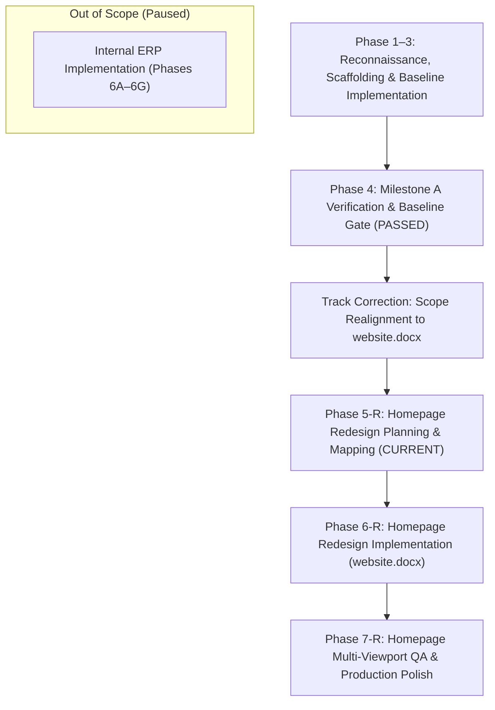

# Octis Website Recreation & Enhancement — Project Plan

## 1. Project Overview & Corrected Scope

This project executes a disciplined engineering workflow to reproduce and modernize the public web presence of Octis ([https://octis.in/](https://octis.in/)), an AI-powered jewellery ERP and management software platform tailored for Indian retail jewellers.

### Active Primary Workstream
```
Public Octis Homepage Clone (Completed)
        ↓
Public Homepage Redesign from "website.docx" (ACTIVE WORKSTREAM)
        ↓
Homepage Multi-Viewport QA, SEO & Production Delivery
```

### Deliverables & Scope Classification
1. **Public Marketing Website (IN SCOPE — Current Priority)**:
   - **Baseline Clone (Completed in Phase 4)**: 100% faithful high-fidelity reconstruction of the live website at `https://octis.in/` and public authentication route `/login`.
   - **Homepage Redesign (Active Task)**: Apply the exact content updates, AI positioning, differentiators, and pricing structure from `website.docx`.
   - **Quality Assurance**: Cross-viewport visual fidelity (Desktop 1440px, Tablet 768px, Mobile 390px), keyboard accessibility, zero document overflow, and SEO metadata integrity.
2. **Internal ERP Modules (EXPLICITLY OUT OF SCOPE FOR CURRENT TASK)**:
   - The developer audit document `OCTIS_UIUX_Complete_Audit_and_Fix_Blueprint.docx` relates to internal ERP workflows (Dashboard, POS Billing, Inventory, Parties, BI, Settings).
   - This track is paused and marked out of scope for the public marketing website task. Code created in Phase 6A/6B remains preserved in the repository but will not be expanded.

---

## 2. Phased Execution Lifecycle



### Phase 1–3: Target Reconnaissance, Asset Harvesting & Baseline Build (COMPLETED)
- Verified and downloaded official logos, icons, photography, and stylesheets from `https://octis.in/`.
- Scaffolding in Next.js 15 App Router, TypeScript strict mode, and Tailwind CSS.
- Built full homepage components (`Hero`, `Features`, `SpotlightSection`, `Compliance`, `Pricing`, `Faq`, `CtaBanner`, `Footer`, `Navbar`).

### Phase 4: Baseline Clone Verification & Public Login (COMPLETED & PASSED)
- Git commit `dc848fc`.
- Homepage covering all 10 sections in exact sequence matching `https://octis.in/`.
- Public login route (`/login`) with official branding and transparent notices.
- Multi-viewport screenshots captured and verified (Desktop 1440, Tablet 768, Mobile 390).

### Phase 5-R: Scope Realignment & Homepage Redesign Mapping (CURRENT PASS)
- **Objective**: Realign project scope to the public website, locate and parse `website.docx` in full, and build an exhaustive requirements map.
- **Deliverables**:
  - `docs/homepage-redesign-plan.md` mapping all 16 numbered sections of `website.docx`.
  - Updated `PROJECT_PLAN.md` with active public website workstream.
  - Updated `docs/implementation-log.md` with scope correction entry.
  - Zero modifications to public homepage or `/login` during this pass.
- **Acceptance Criteria**:
  - `website.docx` located (`C:\Users\srika\Downloads\website.docx`) and verified in full.
  - Internal ERP track classified out of scope.
  - Original baseline clone preserved.

### Phase 6-R: Homepage Redesign Implementation (UPCOMING)
- **Objective**: Implement the 16 content and positioning updates from `website.docx` into `src/app/page.tsx` and public marketing components.
- **Scope**:
  - Hero primary positioning update ("AI-POWERED JEWELLERY ERP").
  - Connected Business Flow ("Metal → ... → AI → Digital Commerce").
  - Core Feature Differentiators (Complete Traceability, Vendor Intelligence, Article Profitability, Tally + Jewellery).
  - Standalone AI Intelligence section ("From Jewellery Software to Jewellery Intelligence", 5 pillars, concrete examples).
  - Pricing progression ("Starter = Run", "Professional = Understand", "Enterprise = Predict • Optimise • Scale").
  - Enterprise customisation callout.
  - Digital Commerce and AI Catalogue creation.
  - Why Octis 8-pillar showcase.
  - Final CTA tiered value messaging.
  - FAQ expansion with 5 AI questions.
  - Preserved SEO H1/H2 hierarchy and natural AI keyword inclusion.
  - Credibility metrics verification gate.

### Phase 7-R: Homepage QA, Cross-Browser & Production Delivery (UPCOMING)
- **Objective**: Full responsive audit, interaction testing, accessibility check, and production build verification.
- **Scope**:
  - Desktop (1440 × 900), Tablet (768 × 1024), and Mobile (390 × 844) validation.
  - Smooth scroll anchor verification (`#features`, `#inventory`, `#compliance`, `#pricing`, `#faq`, `#cta`).
  - Mobile hamburger drawer testing.
  - FAQ accordion keyboard and screen reader accessibility.
  - `npx tsc --noEmit` and `npm run build` clean passage.

---

## 3. Governance Rules & Guardrails

1. **Document Authority**: `website.docx` is the sole authoritative requirements document for the public website. `OCTIS_UIUX_Complete_Audit_and_Fix_Blueprint.docx` is strictly excluded from this track.
2. **Preserve What Works**: Retain existing agency copy, section order, and structure unless specifically amended by `website.docx`.
3. **No Fabricated Claims**: Do not invent metrics, client names, testimonials, or uptime statistics.
4. **Baseline Recoverability**: Public homepage baseline remains cleanly tracked in Git (`f137b04` / `dc848fc`).
