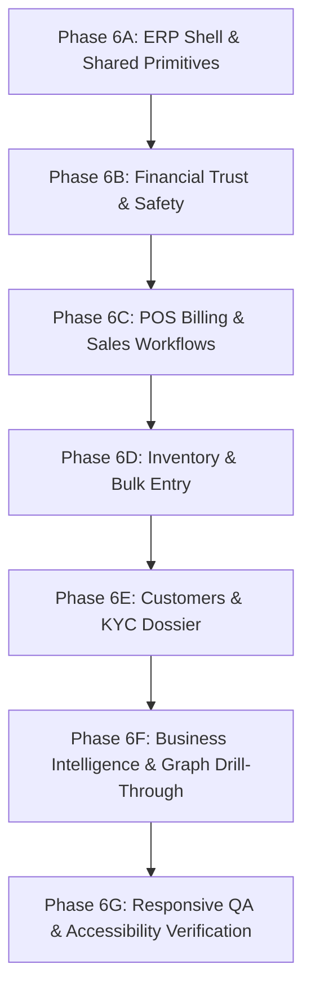

# OCTIS ERP Architecture & Implementation Plan

## 1. Architectural Strategy & Coexistence

The Octis project encompasses two distinct application tiers within a single Next.js 15 App Router codebase:
1. **Public Marketing Website & Authentication Gateway**:
   - `/`: High-fidelity public homepage (Hero, Features, Spotlights, Compliance, Pricing, FAQ, Footer) — preserved strictly without alterations.
   - `/login`: Public authentication gateway with official branding, input accessibility, and transparent external backend service notices — preserved strictly.
2. **Internal Showroom ERP Modules (Milestone B)**:
   - Coexisting alongside the public site using an App Router Route Group `src/app/(erp)/` sharing a dedicated ERP Shell layout (`src/app/(erp)/layout.tsx`).
   - Zero route collisions or layout leakage between public marketing visitors and internal ERP modules.

---

## 2. Proposed ERP Route Inventory (Evidence-Backed)

Every route corresponds directly to views observed in `OCTIS_UIUX_Complete_Audit_and_Fix_Blueprint.docx` and the 24 audit evidence screenshots in `OCTIS_UIUX_Audit_Evidence`:

| Route Path | Module Area | Evidence Screenshot | Primary User Job & Blueprint Scope |
|:---|:---|:---|:---|
| `/dashboard` | Executive Dashboard | `Dashboard_01`, `Dashboard_02` | Monitor sales, daily liquidity, bullion rates, cash/gold receivables, and operational action alerts (`DASH-01`, `DASH-02`). |
| `/sales` | Sales & Billing Management | `POS_04` | Transaction directory, date range filtering, return-bill master-detail selection (`POS-04`, `POS-05`). |
| `/sales/new` | POS Billing Terminal | `POS_01`, `POS_02`, `POS_03` | Instant-rendering cashier terminal, item scanner, integrated metal exchange deduction, inline notes validation (`POS-01`, `POS-02`, `POS-03`). |
| `/inventory` | Inventory Management | `Inventory_01`, `Inventory_03`, `Inventory_04` | Stock catalog, safe alphanumeric tag lookup with error boundary, normalized casing, mobile overflow prevention (`INV-01`, `INV-03`, `INV-04`). |
| `/inventory/bulk` | Bulk Stock Entry | `Inventory_02` | Staged bulk inventory wizard with grouped semantic inputs (Identity, Metal Spec, Purchase Cost, Retail Value) (`INV-02`). |
| `/customers` | Customer Management | `Customers_01`, `Customers_04` | Customer directory with persistent text navigation tabs, clear Store Credit vs Balance Due badges (`CUST-01`, `CUST-03`). |
| `/customers/[id]` | Customer 360 Dossier | `Customers_02`, `Customers_03` | Customer profile, masked Aadhaar/PAN fields with reveal control, transaction history, and informative empty states (`CUST-02`, `CUST-04`, `CUST-05`). |
| `/parties` | Vendor & Bullion Parties | `Parties_01`, `Parties_02`, `Parties_05` | Reconciled Outstanding view matching summary cards, party groups, mobile filter wrapping (`PART-01`, `PART-02`, `PART-07`). |
| `/parties/[id]` | Party Dossier & Ledger | `Parties_03`, `Parties_04` | Unified mini-ledger, explicit running balance direction ("We Owe" / "Party Owes"), metal balance polarity, responsive columns (`PART-03`, `PART-04`, `PART-05`, `PART-06`). |
| `/bi` | Business Intelligence Hub | `BI_01`, `BI_02`, `BI_03`, `BI_04` | Five labeled analytics views, strict Indian Rupee 2-decimal formatting, graph canvas auto-fit/zoom controls, operational deep-link drawer, date range filter, risk exposure hierarchy (`BI-01` to `BI-06`). |

---

## 3. Reusable Component & Pattern Architecture

To guarantee consistency, maintainability, and accessibility across all ERP modules, the following shared UI primitives will be implemented in `src/components/erp/`:

### A. Navigation & Layout Shell
- `ErpShell.tsx`: Root wrapper containing the desktop sidebar, responsive topbar, store selector (`Main Showroom`), live gold/silver rate ticker, notification bell, and staff profile avatar.
- `ErpSidebar.tsx`: High-contrast, accessibility-tested persistent sidebar displaying text labels and icons for all 6 primary modules, with active pill indicators and collapse/expand toggle.
- `ErpMobileNav.tsx`: Touch-friendly slide-over navigation drawer for viewports < 1024px.
- `ErpBreadcrumbs.tsx`: Standardized hierarchical location links (`Dashboard > Parties > Shree Ganesh Bullion`) across all detail pages (`CUST-04`).

### B. Financial Semantics & Metrics
- `SemanticBalanceBadge.tsx`: Directional financial badge eliminating due/credit ambiguity (`CUST-03`, `PART-04`):
  - **Store Credit / Advance**: Emerald badge, positive prefix, label *"Customer Credit"*.
  - **Balance Due / Receivable**: Amber/Red badge, label *"Customer Owes"*.
  - **Vendor Payable**: Blue/Purple badge, label *"We Owe Vendor"*.
  - **Vendor Receivable**: Indigo badge, label *"Vendor Owes Us"*.
- `MetalBalanceBadge.tsx`: Dedicated gold/silver weight indicator showing gross weight, net weight, purity (e.g. `22K (916)`), pure gold equivalent, and direction (`PART-05`).
- `ExecutiveKpiCard.tsx`: Standardized metric card displaying title, formatted value, delta trend, explicit unit, and calculation timestamp (`DASH-02`).

### C. Tables & Data Display
- `ResponsiveDataTable.tsx`: High-density tabular layout with:
  - Sticky identity column (Code, Name, or HUID).
  - Responsive column priority hiding non-essential metrics on smaller screens.
  - Mobile card representation toggle when viewport < 768px (`PART-06`, `INV-04`).
  - Persistent active row selection (`aria-selected="true"`) for master-detail views (`POS-05`).
- `EmptyStateCard.tsx`: Purposeful empty state component featuring icon, explanatory title, description, and primary recovery action (`CUST-05`).

### D. Form Controls & Security
- `DateRangeFilter.tsx`: Unified date filter with standard Indian retail presets (*Today, Yesterday, Last 7 Days, Month-to-Date, Current Quarter, Custom*) with URL search param synchronization (`POS-04`, `BI-05`).
- `MaskedSensitiveField.tsx`: Security field component that masks PAN and Aadhaar numbers by default (`•••• •••• 1234`), providing an explicit eye toggle to reveal with accessible screen-reader notices (`CUST-02`).
- `SafeTagSearchInput.tsx`: Search input with integrated error boundary that gracefully catches invalid tag queries, pre-resolves alphanumeric barcodes, and renders a search-assistance drawer without throwing database exceptions (`INV-01`).

### E. Graph & Visualization Controls
- `BiGraphViewport.tsx`: Canvas container with auto-fit layout calculation on mount, pan/zoom controls, "Fit View" button, and risk-tier badge styling (`BI-03`, `BI-06`).
- `BiNodeDetailDrawer.tsx`: Flyout drawer displaying complete node metrics and prominent operational deep-link buttons routing directly into Inventory, Parties, or POS (`BI-04`).

---

## 4. Mock Data & Client State Strategy

Because this project operates as an independent frontend architecture without direct connections to the closed live Octis production database, client-side mock stores will provide authentic data:

1. **Canonical Party Financial Store (`src/lib/erp/partyStore.ts`)**:
   - Single source of truth for all vendor and customer accounts.
   - Enforces mathematical parity: the sum of individual unpaid vouchers strictly equals the summary card totals on `/parties` and `/parties/[id]`, directly resolving `PART-01`, `PART-02`, and `PART-03`.
2. **Indian Jewellery Domain Catalog (`src/lib/erp/inventoryStore.ts`)**:
   - Realistic jewellery inventory items with HUID tags (`HUID-916-4402`), stone weights, gross weights, making charges, purity tiers (24K, 22K, 18K), and stone categories.
   - Provides safe fallback lookups for `INV-01`.
3. **Live Transaction & POS Store (`src/lib/erp/posStore.ts`)**:
   - Simulates real-time cart state, live metal rate recalculation, scrap/old gold exchange deductions, and GST tax splits (CGST + SGST).
4. **Transparent Documentation Banner**:
   - A subtle header chip on ERP views informing reviewers: *"Octis ERP Demo Mode • Client-Side Canonical Store Active • Live Cloud Service Disconnected"*.

---

## 5. Phased Implementation Sequence

Following the risk-based priority structure specified in Blueprint Table 18:

### Phase 6A: Foundation & Shared Shell
- Build App Router route group `(erp)/layout.tsx`.
- Implement `ErpShell`, `ErpSidebar`, `ErpNav`, and `ErpBreadcrumbs`.
- Implement `src/lib/erp/formatters.ts` (`formatIndianCurrency` with 2-decimal precision, `formatGoldWeight`).
- Create shared `DateRangeFilter` and `SemanticBalanceBadge`.

### Phase 6B: Financial Trust & Data Consistency (P0 Issues)
- Implement `/parties` and `/parties/[id]`.
- Enforce canonical financial store resolving `PART-01`, `PART-02`, `PART-03`.
- Implement explicit balance direction badges (`PART-04`, `PART-05`).
- Implement sticky table headers and responsive drawer (`PART-06`, `PART-07`).

### Phase 6C: Core POS & Sales Terminal (P1 Issues)
- Implement `/sales` and `/sales/new`.
- Implement progressive shell loading with `PosSkeleton` (`POS-01`).
- Embed integrated Metal Exchange settlement workflow into billing terminal (`POS-02`).
- Implement visible required field indicators and inline notes validation (`POS-03`).
- Implement persistent return-bill row selection (`POS-04`, `POS-05`).

### Phase 6D: Safe Inventory & Staged Bulk Inward
- Implement `/inventory` and `/inventory/bulk`.
- Implement safe tag search boundary with controlled recovery state (`INV-01`).
- Build structured bulk entry wizard with grouped semantic fields (`INV-02`).
- Normalize master catalog text casing (`INV-04`) and clean transformation cards (`INV-05`).
- Ensure zero horizontal overflow on mobile viewports (`INV-04`).

### Phase 6E: Customer Management & KYC Security
- Implement `/customers` and `/customers/[id]`.
- Replace icon-only navigation with persistent text tabs (`CUST-01`).
- Implement masked Aadhaar/PAN inputs with reveal control (`CUST-02`).
- Deploy distinct Store Credit vs Balance Due visual styling (`CUST-03`).
- Implement purposeful empty states with next action CTAs (`CUST-05`).

### Phase 6F: Business Intelligence & Graph Views
- Implement `/bi` with 5 labeled text tabs (`BI-01`).
- Implement strictly formatted currency metrics (`BI-02`).
- Implement canvas relationship graph with automated fit-view and zoom controls (`BI-03`).
- Build node detail drawer with deep links into operational records (`BI-04`).
- Attach period `DateRangeFilter` and risk-tiered exposure hierarchy (`BI-05`, `BI-06`).

### Phase 6G: Quality Assurance, Responsive & Accessibility Verification
- Execute multi-viewport visual audits across Desktop (1440px), Tablet (768px), and Mobile (390px).
- Audit keyboard focus rings, ARIA semantics, and color contrast.
- Run `npx tsc --noEmit` and production `npm run build`.
- Capture comprehensive before-and-after comparison screenshots.

---

## 6. Testing & Acceptance Matrix

| Test Category | Target Module | Pass Criteria |
|:---|:---|:---|
| **Mathematical Parity** | Parties (`/parties`) | Outstanding table voucher sum strictly equals summary card total. |
| **Error Containment** | Inventory (`/inventory`) | Searching invalid alphanumeric tag renders recovery search card; 0 raw SQL errors. |
| **Instant POS Shell** | Sales (`/sales/new`) | Page shell renders in < 100ms; skeleton shows while mock masters load. |
| **Payment Net Settlement** | POS Terminal | Total payable accurately deducts metal exchange credit: `Net = Items - Exchange`. |
| **KYC Privacy** | Customers (`/customers/[id]`) | Aadhaar and PAN masked by default; unmasks only on explicit user click. |
| **Graph Viewport Bounds** | BI (`/bi`) | Graph nodes fit completely within canvas on load and tab change without clipping. |
| **Operational Deep Links** | BI Drawer | Clicking "View Ledger" in BI drawer navigates to `/parties/[id]#ledger`. |
| **Responsive Integrity** | All ERP Modules | Zero horizontal scroll on mobile (390px); table converts to card representation. |
| **Keyboard Accessibility** | Global Shell & Modals | Full tab navigation cycle, visible focus rings, escape key dismisses drawers. |
